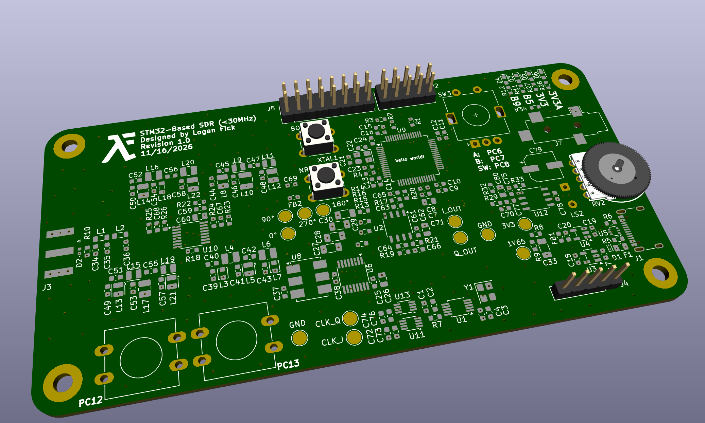
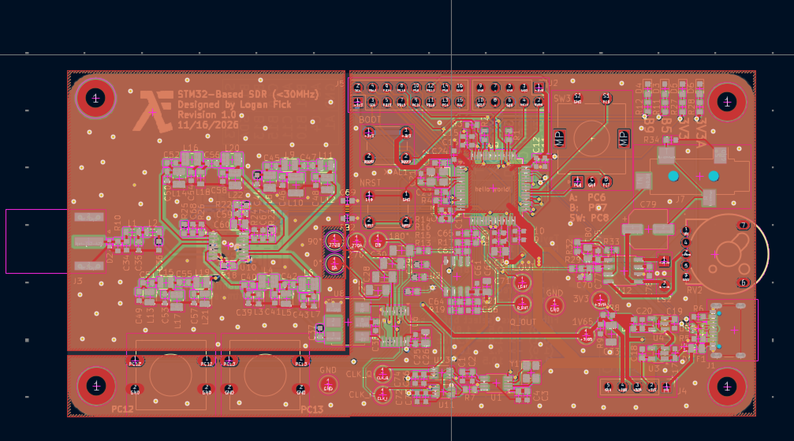

<!-- kicad_template/README.md -->

# STM32-Based SDR Rated for 0.5MHz to 30MHz

This repository contains all KiCad files relating to my STM-32 SDR project.

The board is 4 layers, and 120mm by 60mm. The current version is v1.0, last finished 11/16/2026.

The idea of the project is to make an SDR that can demodulate RF from 0.5MHz to 30MHz, which includes AM broadcasts, some ameteur radio bands, and some digital broadcast signals. For the table I am going to have the project in a 3d printed case for the attendees to see, a poster/display board explaining the key points of it, and my laptop for showing the waterfall/spectrum graph received from it.

See renders from KiCad below.

